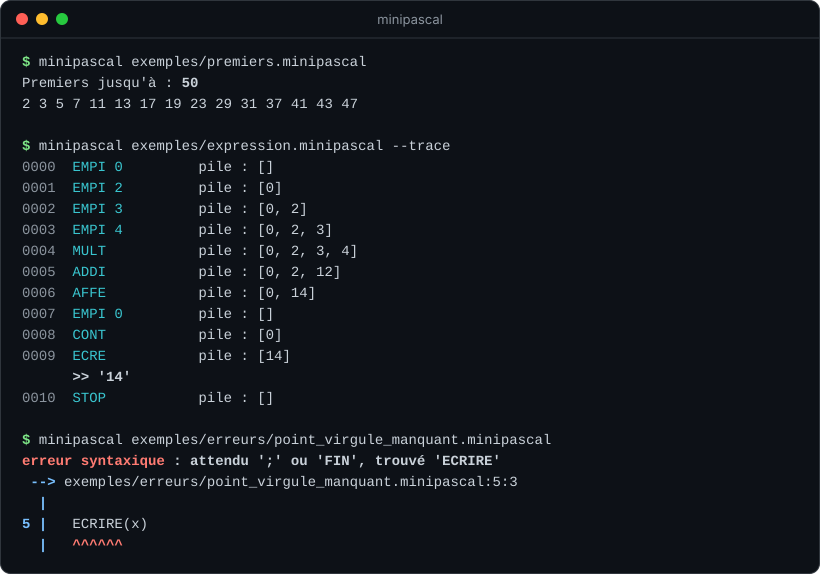
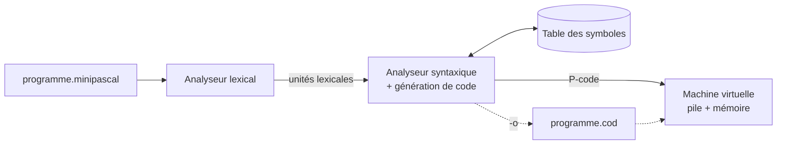

<div align="center">

# MiniPascal

**Un compilateur complet écrit en Python, du code source jusqu'à l'exécution sur une machine virtuelle à pile.**

Analyse lexicale · analyse syntaxique · table des symboles · génération de P-code · machine virtuelle

[](https://github.com/nolancolin/minipascal/actions/workflows/tests.yml)




</div>

## Le projet

MiniPascal est un petit langage inspiré de Pascal, avec des mots-clés en français. Le compilateur
lit un programme, vérifie qu'il est correct, le traduit en **P-code** (un langage d'assemblage pour
une machine à pile, dans l'esprit du P-code de Pascal ou du bytecode Java) puis l'exécute sur sa
propre **machine virtuelle**.

C'est notre projet de Compilation de L3 Informatique, fait en binôme de janvier à avril 2026, en trois
parties : l'analyse lexicale, puis l'analyse syntaxique avec la table des symboles, et enfin la génération
de code et la machine virtuelle. On l'a ensuite repris pour en faire un outil complet et testé.

Ce qui nous paraît le plus intéressant :

- **Une seule passe** : l'analyseur syntaxique génère le code au moment où il reconnaît la grammaire
  (traduction dirigée par la syntaxe), et complète les sauts après coup pour les `SI` et les boucles.
- **Des erreurs précises** : lexicales, syntaxiques, sémantiques et d'exécution, avec la ligne, la colonne
  et la partie fautive soulignée.
- **Une machine virtuelle qui se défend** : division par zéro, variable lue avant d'avoir une valeur,
  dépassement des entiers 64 bits, boucle infinie.
- **Chaque étape est visible** : `--tokens`, `--table`, `--listing` et `--trace` montrent ce que fait
  chaque phase.
- **66 tests**, dont 300 expressions aléatoires comparées à Python et 1 500 programmes abîmés
  au hasard (fuzzing).

## Essayer

Il suffit de Python 3.10 ou plus, sans rien installer :

```bash
git clone https://github.com/nolancolin/minipascal.git
cd minipascal
python Main.py exemples/premiers.minipascal
```

On peut aussi installer la commande `minipascal` :

```bash
pip install .
minipascal exemples/factorielle.minipascal
```

| Option | Effet |
|---|---|
| `-l`, `--listing` | affiche le P-code généré |
| `-t`, `--trace` | exécute pas à pas en montrant la pile |
| `--tokens` | affiche les unités lexicales |
| `--table` | affiche la table des symboles |
| `-c`, `--compiler` | compile sans exécuter (vérification) |
| `-o prog.cod` | enregistre le P-code ; `minipascal prog.cod` l'exécute ensuite |
| `--max-etapes N` | limite le nombre d'instructions exécutées (10 millions par défaut) |

Le dossier [`exemples/`](exemples) contient de quoi tout essayer : factorielle, Fibonacci, PGCD,
nombres premiers, suite de Syracuse, table de multiplication, et des programmes faux dans
[`exemples/erreurs/`](exemples/erreurs).

## Le langage

```pascal
{ Nombres premiers jusqu'à n }
PROGRAMME premiers;
VAR n, i, d, premier;
DEBUT
  ECRIRE("Premiers jusqu'à : ");
  LIRE(n);
  POUR i := 2 JUSQUA n FAIRE
  DEBUT
    premier := 1;
    d := 2;
    TANTQUE d * d <= i ET premier FAIRE
      SI i MOD d = 0 ALORS premier := 0 SINON d := d + 1;
    SI premier ALORS ECRIRE(i, " ")
  FIN;
  ECRIRE()
FIN.
```

- Des **entiers** sur 64 bits, et des **chaînes** pour l'affichage (`CONST message = "Salut";`).
- `SI ... ALORS ... SINON`, `TANTQUE ... FAIRE`, `REPETER ... JUSQUA`, `POUR i := a JUSQUA b FAIRE`.
- Les opérateurs `+ - * / MOD`, les comparaisons `= <> < <= > >=` et `ET`, `OU`, `NON`.
  Comme en C, une condition est un entier : `0` est faux, tout le reste est vrai.
- `LIRE(a, b)` lit au clavier, `ECRIRE(...)` écrit sans retour à la ligne, `ECRIRE()` va à la ligne.
- Commentaires `{ ... }`, qui peuvent s'imbriquer.

<details>
<summary><b>La grammaire complète</b></summary>

```
programme   = "PROGRAMME" id ";" [decl_const] [decl_var] bloc "."
decl_const  = "CONST" id "=" (nombre | chaine) { "," id "=" (nombre | chaine) } ";"
decl_var    = "VAR" id { "," id } ";"
bloc        = "DEBUT" suite "FIN"
suite       = instruction { ";" instruction }
instruction = [ affectation | lecture | ecriture | bloc | si | tantque | repeter | pour ]
affectation = id ":=" exp
lecture     = "LIRE" "(" id { "," id } ")"
ecriture    = "ECRIRE" "(" [ (chaine | exp) { "," (chaine | exp) } ] ")"
si          = "SI" exp "ALORS" instruction [ "SINON" instruction ]
tantque     = "TANTQUE" exp "FAIRE" instruction
repeter     = "REPETER" suite "JUSQUA" exp
pour        = "POUR" id ":=" exp "JUSQUA" exp "FAIRE" instruction

exp         = exp_et { "OU" exp_et }
exp_et      = exp_non { "ET" exp_non }
exp_non     = "NON" exp_non | exp_rel
exp_rel     = exp_arith [ ("=" | "<>" | "<" | "<=" | ">" | ">=") exp_arith ]
exp_arith   = terme { ("+" | "-") terme }
terme       = facteur { ("*" | "/" | "MOD") facteur }
facteur     = nombre | id | "(" exp ")" | "-" facteur | "+" facteur
```

Chaque règle correspond à une méthode du même nom dans
[`analyseur_syntaxique.py`](minipascal/analyseur_syntaxique.py).

</details>

## Comment ça marche



Pour suivre les étapes, prenons [`exemples/expression.minipascal`](exemples/expression.minipascal) :

```pascal
PROGRAMME expression;
VAR x;
DEBUT
  x := 2 + 3 * 4;
  ECRIRE(x)
FIN.
```

### 1. Analyse lexicale

L'analyseur lexical lit le texte caractère par caractère et le découpe en **unités lexicales**, en
sautant les espaces et les commentaires. Chaque unité garde sa ligne et sa colonne pour les messages
d'erreur. Pour la ligne 5 (`--tokens`) :

```
  5:3   id       x
  5:5   aff      :=
  5:8   ent      2
  5:10  plus     +
  5:12  ent      3
  5:14  mult     *
  5:16  ent      4
  5:17  ptvirg   ;
```

### 2. Analyse syntaxique et table des symboles

L'analyseur syntaxique est une **descente récursive** : une méthode par règle de grammaire
(`prog`, `bloc`, `instruction`, `affectation`, `exp`, `terme`...). Il vérifie aussi le sens du
programme avec la table des symboles : `x` doit être déclaré, une constante ne peut pas être
modifiée, une chaîne ne peut pas entrer dans un calcul.

La priorité des opérateurs vient de l'empilement des règles : `exp_arith` gère `+` et `-`, et
appelle `terme`, qui gère `*`, `/` et `MOD`. Le `*` est donc traité « plus bas », et `2 + 3 * 4`
vaut bien `2 + (3 * 4)`. Chaque niveau tourne en boucle plutôt qu'en récursion, ce qui rend les
opérateurs associatifs à gauche : `10 - 3 - 2` vaut `(10 - 3) - 2 = 5`.

### 3. Génération du P-code

Le code est produit pendant l'analyse : quand `terme` a lu `3 * 4`, il a déjà émis `EMPI 3`, `EMPI 4`
puis `MULT`. Une expression devient ainsi du code en notation polonaise inversée (`--listing`) :

```
0000 EMPI 0              ; l.5    adresse de x
0001 EMPI 2              ; l.5
0002 EMPI 3              ; l.5
0003 EMPI 4              ; l.5
0004 MULT                ; l.5    3 * 4
0005 ADDI                ; l.5    2 + 12
0006 AFFE                ; l.5    x := 14
0007 EMPI 0              ; l.6
0008 CONT                ; l.6    valeur de x
0009 ECRE                ; l.6
0010 STOP                ; l.7
```

Pour les structures de contrôle, le compilateur émet un saut dont il ne connaît pas encore la
destination, puis le complète quand il l'a trouvée. Voici `TANTQUE i > 0 FAIRE i := i - 1` :

```
0003 EMPI 0              ; l.5    début de la boucle
0004 CONT                ; l.5
0005 EMPI 0              ; l.5
0006 SUP                 ; l.5    i > 0 ?
0007 ALSN 15             ; l.5    si non, sortir (15 complété après le corps)
0008 EMPI 0              ; l.6
  ...                             i := i - 1
0014 ALLE 3              ; l.6    retour au test
0015 STOP                ; l.7
```

### 4. Exécution sur la machine virtuelle

La machine a une **pile** pour les calculs et une **mémoire** pour les variables. `--trace` montre
la pile avant chaque instruction :

```
0000  EMPI 0         pile : []
0001  EMPI 2         pile : [0]
0002  EMPI 3         pile : [0, 2]
0003  EMPI 4         pile : [0, 2, 3]
0004  MULT           pile : [0, 2, 3, 4]
0005  ADDI           pile : [0, 2, 12]
0006  AFFE           pile : [0, 14]
0007  EMPI 0         pile : []
0008  CONT           pile : [0]
0009  ECRE           pile : [14]
      >> '14'
0010  STOP           pile : []
```

<details>
<summary><b>Toutes les instructions du P-code</b></summary>

| Instruction | Effet |
|---|---|
| `EMPI n` | empile `n` (une constante ou une adresse) |
| `CONT` | dépile une adresse, empile la valeur rangée à cette adresse |
| `AFFE` | dépile une valeur puis une adresse, range la valeur à l'adresse |
| `ADDI` `SOUS` `MULT` `DIVI` `MODU` | dépilent `b` puis `a`, empilent `a op b` |
| `MOIN` | remplace le sommet par son opposé |
| `EGAL` `DIFF` `INF` `INFE` `SUP` `SUPE` | comparaisons, empilent `1` (vrai) ou `0` (faux) |
| `ET` `OU` `NON` | opérations logiques sur 0 / 1 |
| `LIRE` | dépile une adresse et y range un entier lu au clavier |
| `ECRE` / `ECRC "texte"` / `ECRL` | écrit un entier / une chaîne / un retour à la ligne |
| `ALLE a` | saute à l'instruction `a` |
| `ALSN a` | dépile, et saute à `a` si la valeur vaut 0 (« aller si non ») |
| `STOP` | arrête la machine |

La division est tronquée vers zéro et le `MOD` a le signe du dividende, comme en Pascal.

</details>

## Les erreurs

Le compilateur s'arrête à la première erreur et montre exactement où elle se trouve :

```
erreur syntaxique : attendu ';' ou 'FIN', trouvé 'ECRIRE'
 --> exemples/erreurs/point_virgule_manquant.minipascal:5:3
  |
5 |   ECRIRE(x)
  |   ^^^^^^
```

```
erreur lexicale : caractère inattendu '$'
 --> programme.minipascal:4:14
  |
4 |   x := 1 + 2 $ 3
  |              ^
```

```
erreur sémantique : 'pi' est une constante, on ne peut pas la modifier
 --> exemples/erreurs/modification_constante.minipascal:4:3
  |
4 |   pi := 4
  |   ^^
```

Les erreurs d'exécution sont rattachées à la ligne du source grâce au numéro de ligne gardé dans
chaque instruction :

```
erreur d'exécution : division par zéro
 --> programme.minipascal:5
  |
5 |   ECRIRE(100 / x)
```

## Tests

```bash
python -m unittest discover -s tests -t .
```

- **Analyse lexicale** : symboles, positions, commentaires imbriqués, cas d'erreur.
- **Programmes complets** : chaque instruction, priorités, cas limites (`POUR` vide, `SINON` qui
  se rattache au bon `SI`, borne du `POUR` calculée une seule fois...).
- **300 expressions aléatoires** dont le résultat est comparé à un calcul fait en Python.
- **Fuzzing** : 1 500 programmes abîmés au hasard (caractères supprimés, insérés, dupliqués).
  Le compilateur doit toujours répondre par une erreur propre, jamais par un plantage Python.
- **Ligne de commande** et format `.cod` (écriture, relecture, exécution).

Les tests tournent sur GitHub Actions à chaque push, avec Python 3.10, 3.12 et 3.13.

## Organisation du code

```
minipascal/
├── analyseur_lexical.py      analex() et les reco_* : texte -> unités lexicales
├── analyseur_syntaxique.py   descente récursive + génération du P-code
├── table_symboles.py         constantes, variables et leurs adresses mémoire
├── pcode.py                  instructions et format .cod
├── machine_virtuelle.py      pile, mémoire, exécution
├── erreurs.py                les quatre types d'erreurs
└── cli.py                    ligne de commande et affichage des erreurs
exemples/                     programmes de démonstration
tests/                        tests unitaires, de bout en bout et fuzzing
```

## Ce qui a changé depuis la version du TP

La version rendue en avril posait les bases (analyseur lexical, table des symboles, analyseur
syntaxique, machine virtuelle), mais plusieurs choses ne marchaient pas encore : `+` faisait
planter le compilateur, les nombres de plus d'un chiffre étaient tronqués à l'exécution, les
priorités n'étaient pas gérées, et `SI` / `TANTQUE` étaient reconnus mais jamais exécutés.

La version actuelle corrige tout ça et ajoute : les comparaisons et opérateurs logiques, `SINON`,
`REPETER`, `POUR`, les erreurs avec position, les contrôles à l'exécution, le format `.cod`
rechargeable, la trace, et les tests. Les noms du TP (`analex`, `reco_entier`, `prog`, `inst_cond`,
`PILEX`...) sont restés : c'est toujours le même compilateur.

## Pistes pour la suite

- Des **procédures et fonctions** avec récursivité (pile d'appels, instructions `APPEL` / `RETOUR`).
- Des **tableaux** et un vrai type booléen.
- Un **optimiseur** : calculer `2 + 3 * 4` dès la compilation, supprimer les instructions inutiles.
- Signaler **plusieurs erreurs** à la fois en reprenant l'analyse après un `;`.
- Une **version web** pour essayer le langage dans le navigateur.

## Auteurs

Projet réalisé par [Nolan](https://github.com/nolancolin) et [Loghan](https://github.com/MegaVolvirine), L3 Informatique, 2026.
